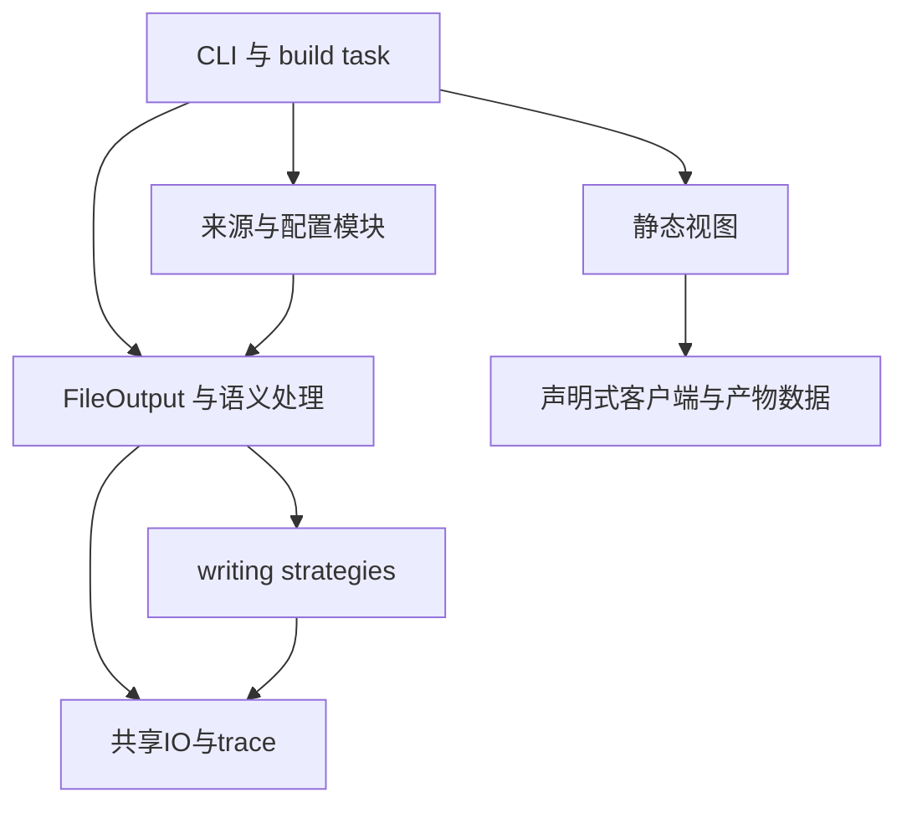

# RuleMesh 工程体系、架构与代码规范

版本：1.2。日期：2026-10-12。状态：**已落实并通过本地工程验收**。现状基线：`ed766d95`；证据见[验收记录](engineering-acceptance.md)。本文件是架构、代码、验证和维护约定的单一入口，不再拆成多套相互重复的规范。

## 1. 当前范围与工程目标

本规范覆盖既定的规则管理项目：Sukka构建链、四主端规则与配置、自定义维护及固定站点分发。验收针对项目交付物、代表性原生行为和工程回归；手机实机、完整GUI流程、系统扩展/VPN连接为补充兼容性验证，不作为项目交付前置条件。

工程目标是：一项知识有一个维护位置；模块可独立阅读、调用和验证；错误不静默消失；规则语义可检查；构建文件集合有明确依据；变更能用合适而快速的检查验证。文件数、抽象层数、测试数量及全量覆盖率不是质量指标。

改法的采用以实际收益为前提，具体准入见[方案第0节](refactor-design.md#0-收益准入通过才采用)。先证明直接修正和既有接口是否足够，再考虑新机制。结构搬迁必须删除旧逻辑并收敛真实调用者；无法达到行为、职责或维护收益的实现撤销，不通过继续加层或降低验收要求保留它。

沿用 Node/pnpm、TypeScript/SWC、Sukka ESLint、Mocha/Earl、FileOutput、writer、worker及trace。新增依赖必须解决实际缺口，比较现有能力后说明取舍；不为重构换工具链。

## 2. 目录责任

### 维护操作

修改人工维护的规则，直接编辑`Source/domainset/`、`Source/non_ip/`或`Source/ip/`对应文件。domainset的`.example.com`包含子域名，`example.com`只匹配该域名；non_ip/ip使用原生规则类型。规则来源和格式遵循该文件已有说明。

MetaCubeX自动同步分类的补充或删除写入`sources/overrides.json`，避免同步覆盖人工修改；每项包含`category`、`value`、`reason`、`evidence`、`checkedAt`。例如：

```json
{
  "category": "anthropic",
  "value": ".claude.app",
  "reason": "Claude Desktop网络要求",
  "evidence": "https://code.claude.com/docs/en/desktop#network-access-requirements",
  "checkedAt": "2026-10-11"
}
```

新增自建分类时，在`Source/`添加文件，在`sources/maintained.json`的`manual`数组登记`path`、`license`、`maintenance`；在`Build/lib/client-config/routing-profile.ts`选定所属策略及排序。已有同步分类不重复登记。固定快照（包括China IP）保留在`maintained.files`，更新时同时审阅来源提交和规则差异。

```sh
pnpm run sync             # 检查上游是否有新候选
pnpm run sync -- --write  # 更新候选规则，供审阅
pnpm run sync:verify      # 核对已固定的服务数据
pnpm exec tsc --noEmit
pnpm test
pnpm lint
pnpm build
PUBLIC_DIR=public pnpm acceptance
```

自动候选经审阅后采用，自有修正会重新应用。发布沿用main的既有CI，校验后更新固定站点；不手工复制未验收产物。人工、固定快照、继承源不得重复声明同一个文件。

| 位置 | 应承担的责任 | 不应承担的责任 |
| --- | --- | --- |
| `Source/` | 人工维护规则与声明式服务数据 | 网络请求、构建编排、客户端节点选择 |
| `sources/` | 固定分类来源、维护归属、带证据修正及批准能力差异 | 生成产物副本、独立规则引擎、用户节点/凭证 |
| `Build/constants/` | 静态常量、来源表、明确环境配置默认值 | import时读取文件、fetch、创建worker、启动任务 |
| `Build/lib/rules/` | 现有语义容器、解析与整理、分发、worker载荷 | GUI文案、配置节点、发布操作 |
| `Build/lib/writing-strategy/` | 各客户端原生格式、能力及实际输出 | 上游fetch、分流目标选择、业务分类先后 |
| `Build/lib/client-config/` | 客户端定义、分类策略和配置渲染/校验 | 站点HTML、二维码IO、网络订阅转换、Git操作 |
| `Build/lib/` 的来源/IO/视图模块 | 聚焦的数据获取、来源核查、文件比较、目录树与静态渲染 | 万能helpers、产品决策、第二套主数据 |
| `Build/build-*.ts` | 一项明确构建任务：取输入、调用已有模块、登记并写出产物 | 重复定义客户端元数据、独立实现通用parser、多个无关职责 |
| `Build/index.ts` | 任务顺序、并发、构建上下文、失败/清理及完成信号 | 规则转换细节、页面内容、CLI参数分支 |
| CLI/维护入口 | 参数、输入输出文件、用户可读错误、进程退出 | 业务算法副本、测试才能调用的私有入口 |
| `Build/trace/` | 观测和诊断，不改变业务结果 | 测试通过条件、产品功能、规则有效性判定 |
| `.github/workflows/` | 调用同一套验证/构建/发布命令及必要凭证 | 重写规则转换、另一套产品配置逻辑 |
| `Modules/`、`Mock/` | 现有可选客户端内容与其资源 | 默认启用未约定的MITM/脚本、被误当测试fixture |
| `public/`、`local/`、`.cache/` | 生成产物、本地输入/结果、可清理缓存 | 源码主数据、唯一不可恢复的维护记录 |
| `docs/` | 当前合同、方案/任务、带日期研究；明确当前与历史状态 | 多份互相竞争的当前规范或无依据完成声明 |

现有命名大小写和路径继承保留。不进行全仓目录搬家或机械性格式重写；新模块放在真实职责已有的目录内。模块拆分必须伴随旧逻辑删除和调用者收敛。

## 3. 依赖方向与接口



依赖约束：

- 入口调用 `lib`，`lib` 不反向 import `build-*.ts`/CLI/index；配置函数从build task抽离后由build/CLI共用。原生验收读取实际交付配置，只替换隔离节点、DNS和规则文件地址，不重新生成另一份配置代替交付验证。
- 策略排序和writer格式分开；writer不 import `routing-profile.ts`，策略模块不依赖HTML。
- 视图消费明确的数据，不扫描HTML推回客户端事实，不再手写四端卡片副本。
- writer可复用既有 `BaseWriteStrategy` 的IO、hash和稳定写入，**不要求为了“纯函数”重建整个输出机制**。
- worker继续调用同一 `writeDataToStrategies`；序列化载荷只能包含可structured-clone的数据，不新增一份worker业务实现。
- Source声明式TS可含接口与数据，不反向依赖网络/构建入口。没有消费者的exports与wrapper不保留。

接口规范：函数输入、输出、错误、顺序和副作用责任必须清楚。优先少量明确函数或现有类；只在真实可变依赖需要时引入adapter。禁止为每个模块都创建工厂、interface、provider、service、repository等模板。

输入上下文仅收敛实际需要的 `outputRoot`、`siteBase` 和任务运行参数。网络/文件依赖在发生处或所属任务注入，禁止扩张成容纳全部资源的service container。

## 4. 必须唯一维护的事实

| 事实 | 唯一位置 | 消费者 |
| --- | --- | --- |
| 客户端ID、规则目录/扩展名、config格式、scheme | `client-config` 内小型静态定义 | 配置写出、CLI、视图、验收 |
| 分类角色、策略组继承、分流顺序 | 现有 `routing-profile.ts` | 配置计划、回归fixture |
| 原生格式支持及投影规则 | 现有writer及其分发诊断 | 能力报告、目标验证 |
| 固定Meta分类和revision | `sources/registry.json` | sync、来源验证 |
| 其他维护归属与快照 | `sources/maintained.json`及继承来源表 | 构建来源验证、说明 |
| 自有add/remove | `sources/overrides.json` | 输入修正、来源验证 |
| 实际文件集合 | 本次task/writer登记结果 | 配置引用、验收、站点 |

writer注册表承担worker复活，客户端定义承担交付元数据，两者保留各自职责并用ID关联。不把规则、版本、页面、全部来源和整个配置实现塞进一个mega registry。

所有视图和脚本里不再保留独立scheme分支。客户端未知ID必须报错，不能用默认else把它当sing-box。静态元数据不声称已完成未发生的GUI验证。

## 5. 运行与资源生命周期

- import模块只声明函数/常量，不开始fetch、文件扫描、持久化或线程。当前顶层网络promise/扫描promise在任务启动时创建，保留任务内的并发预取性能。
- 无网络的语义/配置fixture可以直接导入被测模块。测试不必为了阻止import副作用先伪造多个网络服务。
- task是网络与文件副作用的启动点。每次构建有自己的输入和输出目录，不能复用上次调用残留的可变数组、Set或promise结果。
- 独占资源由打开者在`finally`清理，例如文件句柄、任务自己的服务和计时器。共享worker池由本次构建入口创建并拥有，各任务只借用，不在自己的`finally`关闭共享池。独立执行的任务入口拥有自己的池，采用同一收尾逻辑。
- 构建首次失败后记录原始错误，停止安排新任务；通知支持取消的在途操作，并等待已开始任务结束或取消完成，然后统一关闭共享资源。没有取消能力的操作受已有IO/任务超时约束；超时则终止仍在运行的worker并将整个构建判为失败，不能直接退出后让任务继续写文件。
- 任务在写出及产物登记前检查本次构建状态；构建失败后不接受新的写出/登记，收尾完成后无在途任务继续访问该输出目录。这里使用现有任务编排与清理机制，不新增通用调度/取消框架。
- 清理回调属于每次调用，多个回调均执行并等待完成，不能互相覆盖；关闭未启动资源不触发创建，重复关闭安全。关闭后释放本次池引用，下一次构建创建新池，不借用已终止池。
- 清理失败与原始任务失败同时出现时，原始错误保持首要原因，清理错误另行附带诊断；若任务成功但清理失败，则本次执行仍失败。CLI在收尾之后决定退出码，不能在`finally`无条件退出成功。
- `process.exit`只允许真正CLI/执行入口处理；库模块抛错。现有trace/task main wrapper若负责退出，使用者必须明确它的入口角色。
- 所有输出位置由同次构建的上下文确定。没有多份散落的硬编码siteBase或路径解析规则。
- 性能优化保留实测理由和benchmark；不把每个小函数变成微优化，不用trace结果替代正确性检查。

## 6. 类型、错误与诊断

### 6.1 类型与数据校验

继续TypeScript strict。JSON/YAML/远端返回值先作为`unknown`，在入口校验后进入明确类型。共享interface只承载实际需要的数据；不为每个原始行创建多层领域对象，也不写万能`Record<string, any>`传播到算法内部。

配置输入存在真实的客户端差异，允许原生字段与适配；禁止为统一模型主动丢弃客户端选项。至少校验节点/组/引用的名称、重复和缺失，保留用户字段的范围由配置合同决定，工程规范不擅自增加通用合并模式。

`any`只允许明确的第三方库类型缺口或已经解释的局部操作；限制在小块，尽早转换回已验证类型。新增文件不复制现有整文件eslint-disable注释。

### 6.2 失败规则

必需源读取失败、格式/值错误、未知token、矛盾override、重复产物路径、缺失引用、配置名称冲突，必须中止所属任务并向入口传播。禁止catch后只console.error并返回部分结果。

可选输入、允许空源、已知投影和原生能力缺口不是任意容错：需要来源或目标合同明确允许，返回诊断并列出影响。未知类型不能自动归为已批准缺口。

错误最少包含：任务/操作、源文件或脱敏URL、可用行号、分类、目标客户端、类型和原因；保留`cause`。不能把token、认证头、完整用户订阅和含凭证节点写进日志。

优先普通Error及少量稳定诊断码，不为每种失败新建继承类，不强制引入通用Result/Either框架。stdout可用于CLI结果，诊断用stderr，build日志保持可识别。

### 6.3 语义不变量

原子规则之间独立OR；复合输入保留显式逻辑。exact/suffix/wildcard/keyword不互换；resolution意图不丢；跨策略不去重；关键词白名单真正作用于最终结果。支持条件的转换错误不能用能力批准掩盖。

主线程与worker输出及诊断一致。parser/语义数据是来源事实，能力报告不能只从另一个writer输出反向推断；不可支持项必须可追溯到被省略的原始条件。

本次工程可以修复已有证据的正确性缺陷。它们按意图修复单独展示产物变化；不得把业务来源选择、默认DNS/出口等决策藏在重构中。

## 7. 代码可读性与复杂度

- 一段代码按一个清晰步骤组织；避免解析、扫描、策略选择、渲染、IO、审批全部挤在同一函数。
- 一行一项主要操作，控制流展开。保留Sukka工具链自动格式；不设全仓强制行数/函数行数指标。
- 优先清楚的类型和命名；ID、路径、绝对URL、策略名分别表达，避免一串string在调用链里代表不同含义。
- 注释解释规则意图、客户端语义、性能原因和边界；不逐行翻译代码。已过时的注释必须随行为修改。
- 真正重复的客户端/配置行为集中；四个格式不同的renderers不必为少几行硬抽象成条件密集的通用renderer。
- 不保留一层仅转发的compatibility exports。模块迁移后一次性改完调用点，删除旧定义。
- 对返回数组/对象是否可变明确约定；纯转换不修改调用者底稿，排序不意外改输入。构建builder可可变，但归同次构建所有。
- lint通过是底线，可维护性仍需审阅。禁止通过大面积关规则让新代码“绿”。

## 8. 构建、输出与缓存合同

工程首先保证**文件集合正确、引用完整、相同已保存输入的语义内容稳定**。不把全站字节重放平台作为当前重构必要条件。

- 本次输出集合由实际task/writer登记：最小字段为relativePath、producer及必要的client/category/format/role；不要重复存可推导数据，也不为每份文件人工填注册表。
- 同一路径出现两个producer时报错；静态Modules/Mock复制同样登记；辅助输出不用假装代理ruleset。
- 旧数据按用途分开：参与测速域名并集的历史规则、实际采用的Mock后备字节是**历史输入**，不是缓存；内容hash比较、下载缓存和Last Updated复用才是缓存。仅本次登记文件可进入交付树；被删除的source/任务产物不残留。
- 比较hash和保留Last Updated沿用现有机制。冷/热比较必须使用相同的人工、固定、动态及历史输入，区别仅是缓存有无；比较同文件集合和去除明确banner时间字段后的内容。历史输入变化允许产生可解释的规则/资源变化；纯缓存有无不得改变规则语义。配置和JSON无volatile字段的要求字节一致。
- 当前时间只属于运行记录。源版本、来源说明等会影响实际内容的元数据不能当“注释”任意忽略。哪些字段排除必须列清单，不能整文件跳过比较。
- 必需动态源依赖和使用的URL/hash记录足够定位本次输入；保存关键语义回归fixture。全量原始网络抓取存档、长期快照及重放保留政策暂不新增。
- 历史输入以具名条目记录来源、用途、实际采用字节的hash及必需/可选合同。它可以从核对过的旧产物提取，但提取后只作为该任务输入，不恢复旧目录作为输出。测试fixture携带用到的历史输入；必需输入缺失报错，可选缺失按已声明合同处理并记录，不能静默换成空集合。Mock是否采用后备也属于输入选择，比较时必须固定。
- 保留这些历史输入的许可与行为。下载缓存提供的数据也须符合本次固定输入身份；来源内容不同属于输入变化，不能按cache hit掩盖。禁止复制所有旧文件再用不断扩大的删除黑名单补救。
- 只有全部必需任务、相应校验和资源收尾成功后产生完成信号，失败不更新公开站点；本次开始前清除旧完成信号，避免清理失败后仍留下本次“成功”。临时工作目录只是构建工作区，不形成公开prepared/stable或版本目录。

## 9. 测试体系

| 层次 | 保护对象 | 运行方式 | 不应代替什么 |
| --- | --- | --- | --- |
| 小型行为测试 | parser/白名单/独立语义、overlay校验、重复/冲突、目录事实 | Mocha/Earl，保存fixture，无第三方网络 | 四端真实接入 |
| 本地集成测试 | 输出文件集合、引用、删除、缓存、配置依赖、worker一致性 | 临时目录、受控读写/故障 | 实际HTTP下载和平台GUI |
| 原生验证 | 配置/规则编译、代表路由、混合条件真值表 | 固定binary及hash，loopback节点/DNS | GUI选择、真实节点更新 |
| 补充兼容性验证 | 特定GUI/设备的安装、连接与更新行为 | 有对应环境时记录平台/版本/步骤 | 项目交付验收；环境缺失不阻塞规则/配置验证 |

新增测试必须指向重要行为或已确认回归。代码搬迁优先运行原有测试，必要时用新接口测试替换浅层测试；禁止同时保留两套覆盖同一内部实现的测试。

### 9.1 重构行为基线

E01必须在实现修改前准备受影响职责的代表性fixture与比较记录。基线记录固定：源码`ed766d95`、输入字节/hash（含用到的历史输入及Mock后备选择）、目标格式、必要的运行工具身份、当前输出/失败结果和比较字段。由该提交的代码在隔离临时目录生成；禁止从当前`public/`复制并推定其属于该提交，也不临时在线抓取两份不同输入来比较。

只保留能保护核心行为的少量fixture，不存整站逐行golden快照。正向样例覆盖正常语义与路径；已确认故障记录旧结果和预期正确结果，例如白名单、sing-box独立条件、未知类型、读流中断、override错误分类。错误结果是修复前证据，不作为新实现必须保持的行为。

比较先核对输入身份与文件集合，再按输出合同比较内容；仅排除明确Last Updated字段，无volatile字段的JSON/config比较字节。每项已确认修复列输入、旧结果、新预期、允许变化范围和证据；其他变化必须解释并审阅，不能用“重构差异”一律豁免。新增真实风险才补fixture，不为满足数量增加测试。

该记录由既有测试fixture及简短变更说明承担，不建立基线管理服务、全量网络快照库或第二套测试runner。

不测试按钮文字/计数、文件是否被拆开、导出名称列表、纯样式。测试可以检查真实href/目标文件、引用与动作合同；复制行为要执行后观察，不查源码里有没有Copied。

对sing-box混合条件至少测单条件命中、另一条件命中、都命中、都不命中；修改解析语义不只编译。故障测试覆盖读取中断、未知类型、缺引用和错误分类。节点fixture无凭证，且至少两个可区分观察点。

测试跨越调用者真正使用的interface；私有实现替换不应迫使测试全部改写。注入仅用于真实外部/IO依赖，避免引入专门给测试用的公开调试接口。

## 10. 检查与迭代效率

现有命令继续使用：`pnpm exec tsc --noEmit`、`pnpm test`、`pnpm lint`、`pnpm build`、`PUBLIC_DIR=public pnpm acceptance`、`pnpm native:routing`。文档不假装新增命令已经实现。

| 改动范围 | 开发时检查 | 集成完成时增加 |
| --- | --- | --- |
| 纯文档/文案/样式 | diff、链接、实际视图（有行为变化才测） | 不增加镜像实现单测 |
| 类型/模块迁移/可读性 | tsc + 涉及的已有测试 + lint | 调用图和旧代码删除检查 |
| 规则解析/writer/能力 | 目标行为/真值表 + tsc/lint | 相关native、主线程/worker、产物diff |
| 来源同步/override | 本地固定数据fixture/故障/幂等 | 固定源校验；候选准确SHA |
| build/文件集合/cache | 临时目录fixture/clean-warm/删除 | 同份输入full build + artifact/reference验收 |
| workflow | schema/权限/事件/命令核对 | 对应受控CI路径，不触发无关设备验收 |

完整网络构建和四端设备验收不为每次普通文件编辑重跑；发生新语义、输入、引用或构建风险时扩大检查。通过后不无理由重复。证据记录用已有CI summary/测试结果及聚焦记录，不建独立审计平台。

## 11. CI、维护与依赖规范

- source PR和main使用同一套检查命令；生成差异同时有可读摘要和必要patch。不能只给diff --stat。
- sync对相同输入幂等，复用已有候选；准确候选SHA需要实际检查结果。错误重试只针对临时网络故障，校验失败不可无限重试。
- main发布用同份已通过树，确认固定站点源码标记；不引入新发布系统。权限按任务最小范围，固定Action与原生binary身份。
- Node/pnpm以版本文件及packageManager为准；CI安装使用lockfile；不在CI偷偷改全局设置绕过依赖政策。改依赖同时提交lockfile和理由。
- manual/pinned/dynamic来源保持不同更新责任；source文件与登记闭合，但继承来源可集中引用明确的Sukka提交，不逐文件复制大量元数据。
- 保留AGPL、NOTICE和第三方许可；不把日志中的“来自某URL”当成完整许可决定。
- benchmark/域名调查为可选维护工具，其workflow必须有效，不能因main通过就假装所有workflow可运行。
- lint已有warning需分类：本次触及区域整改，未触及遗留项记录；不为达零warning机械重写全仓，也不新增全局suppression。

## 12. 文档与变更规范

当前入口为本文件、重构方案、任务清单；分析/研究保留日期和基线。当前规范与实际落地状态分开：每项只有实现和必要验证成立后，才更新完成状态。

变更说明写具体问题、结果、为什么这样改、验证与限制。重构不夹带无依据数据调整；已复现的语义修复列输入及前后结果。代码注释、README、采用清单和artifact角色应随实现同步，避免补一份旁路解释掩盖旧文档错误。

评审检查：模块interface是否清楚；依赖是否逆向/循环；同一事实是否重复；异常是否传播；IO是否可控；行为/引用/文件集合是否保护；测试是否高价值；继承与许可是否保留；是否制造新框架或兼容残层。

## 13. 工程完成条件

工程规范化完成必须同时满足：

1. 架构责任与依赖符合本文，关键调用图可解释，没有第二规则引擎。
2. 原有重要行为有保护，已确认读取/关键词/混合语义/unknown/override等工程缺陷有正确接口回归。
3. 模块import不做网络/持久化/线程工作，共享资源有唯一所有者，失败后在途任务收尾并关闭，无跨次构建残留。
4. 客户端元数据唯一，构建、CLI、视图、验收消费同一事实；业务默认不因迁移改变。
5. 文件集合及引用完整，历史输入与缓存分开，旧文件无法隐式进入新树；clean/warm在相同全部输入下等价，差异可对照E01基线解释。
6. tsc、相关测试、lint、完整集成构建及native检查按变更风险通过；无需用重复设备测试拖慢结构整理。
7. 旧重复代码和无用wrapper被删；继承支持与当前状态准确；未实现的产品事项仍标未定。

完整项目验收在工程检查之外，还要核对分类覆盖与冲突优先级、多端格式与配置、自定义维护、固定站点及导入入口。客户端内部完整GUI流程和手机/VPN连接不属于必需项目门槛；已经完成的原生行为测试按其实际范围记录，不扩大为所有环境均已验证。
